<div align="center">


### Golden paths · Self-service · GitOps · Guardrails · SRE

[](https://aws.amazon.com/)
[](https://aws.amazon.com/eks/)
[](https://developer.hashicorp.com/terraform)
[](https://backstage.io/)
[](https://argo-cd.readthedocs.io/)

**An AWS-oriented Platform Engineering reference blueprint for giving application teams secure, repeatable paved roads instead of fragmented infrastructure tickets and bespoke deployment pipelines.**

[Architecture](#-platform-architecture) · [Golden path](#-developer-golden-path) · [Getting started](#-getting-started) · [Delivery status](docs/DELIVERY-STATUS.md)

</div>

> [!NOTE]
> This repository is built incrementally. The diagrams describe the target platform; delivery evidence is tracked in [Delivery Status](docs/DELIVERY-STATUS.md). Terraform AWS foundation, EKS, Backstage and Argo CD are not represented as deployed unless that status file records evidence.

## Why an internal developer platform?

As engineering organizations scale, teams repeatedly solve the same problems: provisioning environments, creating repositories, configuring CI, securing secrets, deploying workloads and understanding service health. An IDP packages approved patterns into self-service workflows while retaining platform-level controls.

## Platform architecture

<p align="center">
  
</p>

The platform is organized into four planes:

| Plane | Responsibility | Target components |
|---|---|---|
| Experience | Developer entry point and service catalogue | Backstage, templates, documentation |
| Control | Provisioning, policy and deployment orchestration | Terraform, GitHub Actions, Argo CD, Kyverno |
| Runtime | Workload scheduling and service execution | AWS VPC, EKS, Kubernetes, ECR |
| Trust & operations | Identity, secrets, telemetry and recovery | IAM/OIDC, Secrets Manager, Prometheus, Grafana, Loki, OpenTelemetry |

## Developer golden path

```mermaid
flowchart LR
  Dev[Developer] --> Portal[Service catalogue]
  Portal --> Template[Reviewed golden-path template]
  Template --> Repo[New service repository]
  Repo --> CI[Build + test + security checks]
  CI --> Image[Versioned container artifact]
  Image --> GitOps[GitOps deployment change]
  GitOps --> Policy[Admission and policy controls]
  Policy --> Runtime[EKS workload]
  Runtime --> Observe[Telemetry + SLOs]
```

<p align="center">
  
</p>



The goal is self-service with guardrails: teams can move quickly inside supported patterns, while exceptions remain visible and reviewable.

## Capability map

| Capability | Intended implementation | Engineering outcome |
|---|---|---|
| Cloud foundation | AWS VPC, EKS, IAM, KMS, ECR | Isolated workload runtime |
| Infrastructure as Code | Terraform modules and remote state | Repeatable provisioning |
| Developer experience | Backstage catalogue and templates | Discoverable self-service |
| Delivery | GitHub Actions and Argo CD | Auditable CI and GitOps |
| Policy | Kyverno | Admission-time controls |
| Supply chain | Trivy, SBOM and signing patterns | Artifact traceability |
| Secrets | AWS Secrets Manager and External Secrets | No plaintext secrets in Git |
| Observability | Prometheus, Grafana, Loki, OpenTelemetry | Service health and SLO context |

## Getting started

### Prerequisites

Git, Terraform, AWS CLI v2, Docker or an OCI-compatible builder, kubectl and Helm. AWS deployment additionally requires an account, an approved identity and permissions for the resources being created.

Clone and run the repository validation helper:

```bash
git clone https://github.com/haqueamir70-coder/enterprise-internal-developer-platform.git
cd enterprise-internal-developer-platform
bash scripts/validate-repo.sh
```

Before provisioning, read the [Terraform deployment guide](infrastructure/terraform/README.md). Verify AWS account, region, CIDR overlap, IAM trust, remote-state design, public exposure and estimated cost before any apply.

## Security principles

- **Identity first:** use GitHub OIDC with tightly scoped IAM trust.
- **Private by default:** keep worker nodes and data-plane components in private subnets; expose only reviewed entry points.
- **Separate identities:** provisioning, deployment and runtime workloads must not share broad permissions.
- **No plaintext secrets:** retrieve runtime secrets from an approved secret store.
- **Policy before production:** enforce non-root execution, resource limits, approved registries and restricted privileges.
- **Traceable artifacts:** scan, inventory and sign build outputs where implemented.
- **Auditable changes:** route infrastructure and production changes through version control and review.

See [threat model](docs/security/threat-model.md) and [security controls](docs/security/controls.md).

## Operating model

A platform is not production-ready just because a cluster is running. Each golden path needs a named owner, service health signals, an SLO, actionable alerts, rollback instructions, security evidence and recovery expectations.

- [SLO framework](docs/operations/slo-framework.md)
- [Incident response](docs/operations/incident-response.md)
- [Disaster recovery](docs/operations/disaster-recovery.md)
- [Senior engineering scenarios](docs/platform/senior-engineering-scenarios.md)

## Delivery roadmap

| Milestone | Scope | Current state |
|---|---|---|
| M0 | Architecture, repository standards, threat model | Foundation created |
| M1 | Terraform AWS network and EKS foundation | Planned |
| M2 | Sample workload, hardened image and CI security | Planned |
| M3 | Argo CD GitOps and policy enforcement | Planned |
| M4 | Backstage catalogue and golden-path template | Planned |
| M5 | Secrets integration, observability and SLO dashboards | Planned |
| M6 | Resilience tests, DR exercise and evidence | Planned |

See [Delivery Status](docs/DELIVERY-STATUS.md) for the authoritative implementation record.

## Repository map

```text
.github/workflows/        CI and repository automation
docs/architecture/        Architecture diagrams
docs/adr/                 Architecture decision records
docs/operations/           SLO, incident and DR runbooks
docs/security/             Threat model and controls
docs/platform/             Golden paths and operating model
infrastructure/terraform/  AWS foundation (planned milestone)
platform/                  Backstage, GitOps and policies
services/                  Sample workload
scripts/                   Local validation helpers
```

## Cloud portability

The primary target is **AWS EKS**. Azure equivalents are documented separately in [AWS–Azure service mapping](docs/platform/aws-azure-service-mapping.md); service names and icons are not mixed into the AWS deployment design.

## Contributing

See [CONTRIBUTING.md](CONTRIBUTING.md). Never commit credentials, Terraform state, customer data or generated secrets.

## License

MIT — see [LICENSE](LICENSE).

## Maintainer

**MD Amirul Haque** · [GitHub](https://github.com/haqueamir70-coder) · [LinkedIn](https://www.linkedin.com/in/md-amirul-haque/)

<sub>Make the secure path the easiest path for developers.</sub>
