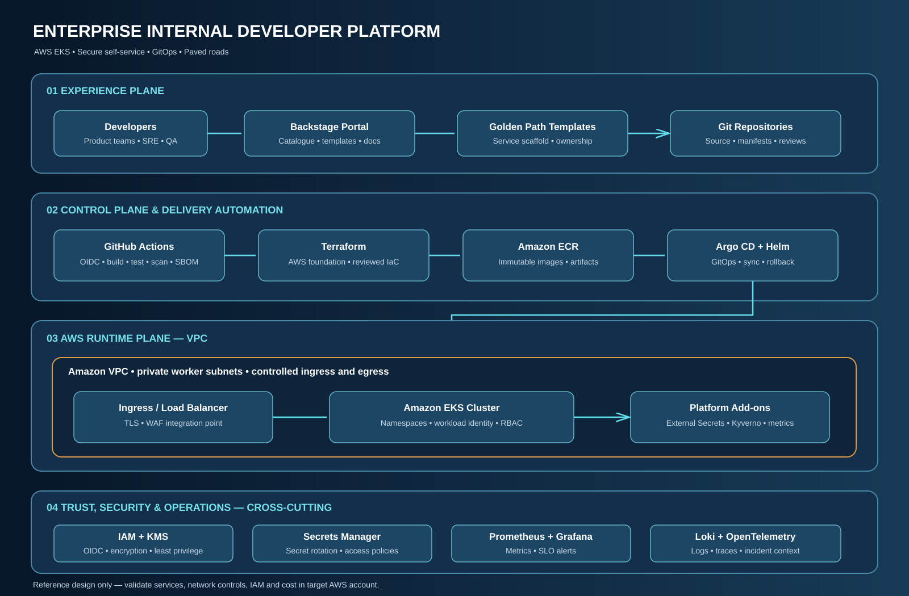
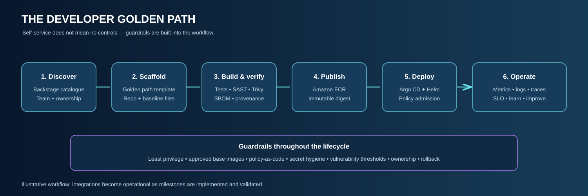

<div align="center">

# 🚀 Enterprise Internal Developer Platform
### A Production-Oriented Platform Engineering Reference Implementation

**Self-service infrastructure • Golden paths • GitOps • Policy-as-Code • Supply-chain security • SRE**

[](https://aws.amazon.com/)
[](https://aws.amazon.com/eks/)
[](https://developer.hashicorp.com/terraform)
[](https://argo-cd.readthedocs.io/)
[](https://backstage.io/)

*An opinionated blueprint for a secure, observable and scalable internal developer platform on AWS.*

</div>

---

## Why this platform?

Engineering teams lose time navigating infrastructure tickets, inconsistent templates, fragmented deployment workflows and late security checks. This project demonstrates how a Platform Engineering team can provide **paved roads**: secure, repeatable self-service workflows that let application teams focus on delivery.

This is an engineering reference implementation built incrementally. Diagrams describe the target design; implementation evidence is tracked in [Delivery Status](docs/DELIVERY-STATUS.md).

## Platform capabilities

| Capability | Target technology | Outcome |
|---|---|---|
| Cloud foundation | AWS VPC, EKS, IAM, KMS, ECR | Isolated, identity-driven runtime |
| Infrastructure as Code | Terraform modules and remote state | Repeatable, reviewed provisioning |
| Developer experience | Backstage | Service catalogue and self-service |
| Workload delivery | Argo CD, Helm, GitOps | Declarative, auditable deployment |
| Workload policy | Kyverno | Admission-time guardrails |
| Supply-chain security | Trivy, SBOM, image signing design | Traceable artifacts |
| Secrets | AWS Secrets Manager, External Secrets | No secrets in Git |
| Observability | Prometheus, Grafana, Loki, OpenTelemetry | SLI/SLO and incident context |
| CI identity | GitHub Actions + AWS OIDC | Short-lived cloud identity |

## Architecture

### Executive architecture



The design has four logical planes: **Experience** (Backstage and golden paths), **Control** (CI, Terraform, GitOps and policies), **Runtime** (EKS workloads) and **Trust & Operations** (identity, secrets, telemetry and audit).

### Developer golden path



A developer starts from a reviewed service template, receives a repository scaffold, passes quality and security gates, and deploys through GitOps. Production access is governed by policy and operational readiness—not manual bypasses.

## Repository map

```text
.
├── .github/workflows/       # CI and repository automation
├── docs/
│   ├── architecture/        # Architecture diagrams
│   ├── adr/                 # Architecture decisions
│   ├── operations/          # SLO, incident and DR runbooks
│   ├── security/            # Threat model and controls
│   └── platform/            # Golden paths and operating model
├── infrastructure/terraform/# AWS foundation (next implementation milestone)
├── platform/                # Backstage, GitOps and policies
├── services/                # Sample workload
└── scripts/                 # Local validation helpers
```

## Security principles

- **Identity first:** GitHub Actions authenticates through OIDC with tightly scoped IAM trust.
- **Private by default:** EKS worker nodes and data-plane components use private subnets; expose only required entry points.
- **Least privilege:** Separate provisioning, deployment and workload identities.
- **No plaintext secrets:** Retrieve runtime secrets from AWS Secrets Manager.
- **Policy before production:** Enforce non-root containers, resource limits, approved registries and restricted privileges.
- **Traceable artifacts:** Generate SBOMs, scan images and preserve provenance.
- **Auditable changes:** Infrastructure and production changes flow through version control and review.

See [Threat Model](docs/security/threat-model.md) and [Security Controls](docs/security/controls.md).

## Getting started

### Prerequisites

Git, Terraform, AWS CLI v2, Docker or a compatible OCI builder, kubectl and Helm. Cloud deployment requires an AWS account and authorization to create resources.

```bash
git clone https://github.com/haqueamir70-coder/enterprise-internal-developer-platform.git
cd enterprise-internal-developer-platform
bash scripts/validate-repo.sh
```

Review [Terraform deployment guide](infrastructure/terraform/README.md) before provisioning. Do not run `terraform apply` until account, region, network overlap, IAM, state storage, exposure and cost have been reviewed.

## Operating model

A platform is not production-ready merely because a cluster is running. Each golden path needs a documented owner, health/latency/traffic/saturation signals, service-level objective, alert policy, rollback instructions, security evidence and recovery expectations.

- [SLO framework](docs/operations/slo-framework.md)
- [Incident runbook](docs/operations/incident-response.md)
- [Disaster recovery](docs/operations/disaster-recovery.md)
- [Senior engineering scenarios](docs/platform/senior-engineering-scenarios.md)

## Delivery roadmap

| Milestone | Scope | Status |
|---|---|---|
| M0 | Architecture, repository standards, threat model | Foundation created |
| M1 | Terraform AWS network and EKS foundation | Planned |
| M2 | Sample workload, hardened image and CI security | Planned |
| M3 | Argo CD GitOps and policy enforcement | Planned |
| M4 | Backstage catalogue and golden path template | Planned |
| M5 | Secrets integration, observability and SLO dashboards | Planned |
| M6 | Resilience tests, DR exercise and evidence | Planned |

See [Delivery Status](docs/DELIVERY-STATUS.md). A green documentation check is not evidence of an AWS deployment.

## Senior engineering discussion topics

Multi-account AWS strategy, private EKS design, Terraform state and drift, developer experience metrics, GitOps reconciliation, supply-chain security, identity federation, admission control, SLOs, capacity planning and disaster recovery.

## Cloud portability

The primary implementation target is **AWS EKS**. Azure equivalents are documented separately; Azure service names and icons are intentionally not mixed into the AWS deployment architecture. See [AWS–Azure mapping](docs/platform/aws-azure-service-mapping.md).

## Contributing

See [CONTRIBUTING.md](CONTRIBUTING.md). Never commit credentials, state files, customer data or generated secrets.

## License

MIT — see [LICENSE](LICENSE).

<div align="center">

**A practical Platform Engineering portfolio project.**  
Target architecture is clearly distinguished from deployed and tested evidence.

</div>


## Architecture and interview preparation

See the [architecture diagram and interview questions](docs/README.md) for the repository-specific design walkthrough and technical interview guide.
