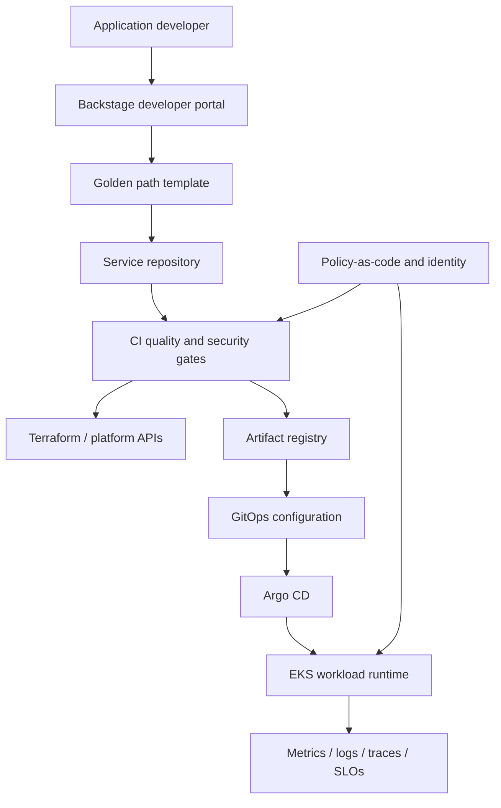

# Enterprise internal developer platform — Architecture & Interview Guide

Target-state platform architecture for Backstage, golden paths, Terraform, GitOps, policy and observability. The README roadmap marks several implementation milestones as planned.

## Architecture diagram

## Interview questions

1. 1. What problem does an Internal Developer Platform solve?
2. 2. What is the difference between a platform and a developer portal?
3. 3. How do Backstage software templates implement golden paths?
4. 4. How do you measure developer experience and platform adoption?
5. 5. How do Terraform modules expose safe self-service capabilities?
6. 6. How does GitOps manage deployment drift?
7. 7. How do you integrate supply-chain security into golden paths?
8. 8. How do you enforce workload policies without blocking developer productivity?
9. 9. What platform SLOs and operational ownership model are required?
10. 10. Which components are implemented versus planned in this repository today?

## Interview preparation note
For every answer, explain the architecture, trust boundary, failure mode, telemetry, cost implication and validation evidence. Distinguish implemented, CI-validated, cloud-deployed and planned capabilities.

## Interview questions — suggested answers

### 1. Answer

An IDP reduces cognitive load and ticket-driven friction by offering supported self-service workflows, standardized templates, secure defaults and clear ownership.

### 2. Answer

A platform is the capabilities, APIs, workflows and operating model; a developer portal is a user interface/catalogue that exposes some of those capabilities.

### 3. Answer

Backstage templates scaffold repositories and metadata, invoke approved automation and encode standards. Templates should be versioned and tested like product code.

### 4. Answer

Measure lead time to first deploy, deployment frequency, template adoption, paved-road success rate, developer satisfaction and toil reduction.

### 5. Answer

Terraform modules expose approved infrastructure choices with typed inputs, guardrails and outputs. Avoid giving developers unrestricted raw cloud permissions.

### 6. Answer

GitOps controllers compare Git desired state with cluster state and reconcile drift. Changes flow through reviewed commits for traceability.

### 7. Answer

Integrate dependency/secret/image scans, SBOM, signing/provenance, policy checks and admission enforcement into templates and delivery workflows.

### 8. Answer

Use policy in CI and admission, provide clear remediation feedback and create exception workflows with owners and expiry. Avoid opaque blanket denies.

### 9. Answer

Define platform availability, template generation success, deployment lead time and support response SLOs. Assign service ownership, on-call and lifecycle responsibilities.

### 10. Answer

The repository explicitly marks AWS Terraform foundation and other milestones as planned. Discuss them as target architecture, not completed platform functionality.

## Complete zero-to-hero guide

See [ZERO-TO-HERO.md](./ZERO-TO-HERO.md) for the business scenario, architecture walkthrough, tool-by-tool explanations, implementation sequence, practical commands, troubleshooting playbook and additional scenario-based interview questions with answers.
