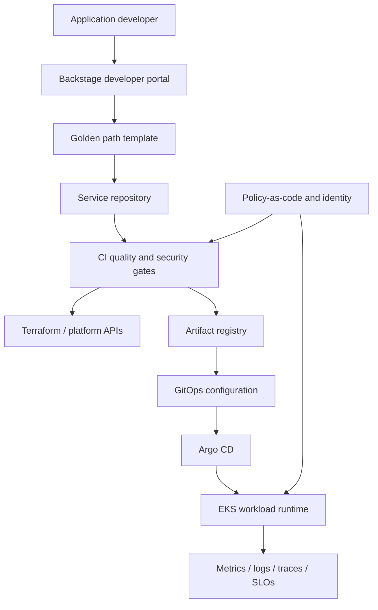

# Enterprise internal developer platform — Architecture & Interview Guide

Target-state platform architecture for Backstage, golden paths, Terraform, GitOps, policy and observability. The README roadmap marks several implementation milestones as planned.

## Architecture diagram

## Interview questions

1. 1. What problem does an Internal Developer Platform solve?
2. 2. What is the difference between a platform and a developer portal?
3. 3. How do Backstage software templates implement golden paths?
4. 4. How do you measure developer experience and platform adoption?
5. 5. How do Terraform modules expose safe self-service capabilities?
6. 6. How does GitOps manage deployment drift?
7. 7. How do you integrate supply-chain security into golden paths?
8. 8. How do you enforce workload policies without blocking developer productivity?
9. 9. What platform SLOs and operational ownership model are required?
10. 10. Which components are implemented versus planned in this repository today?

## Interview preparation note
For every answer, explain the architecture, trust boundary, failure mode, telemetry, cost implication and validation evidence. Distinguish implemented, CI-validated, cloud-deployed and planned capabilities.
