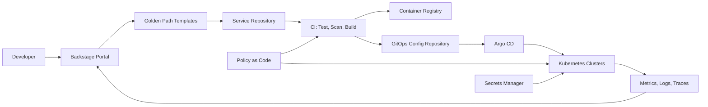
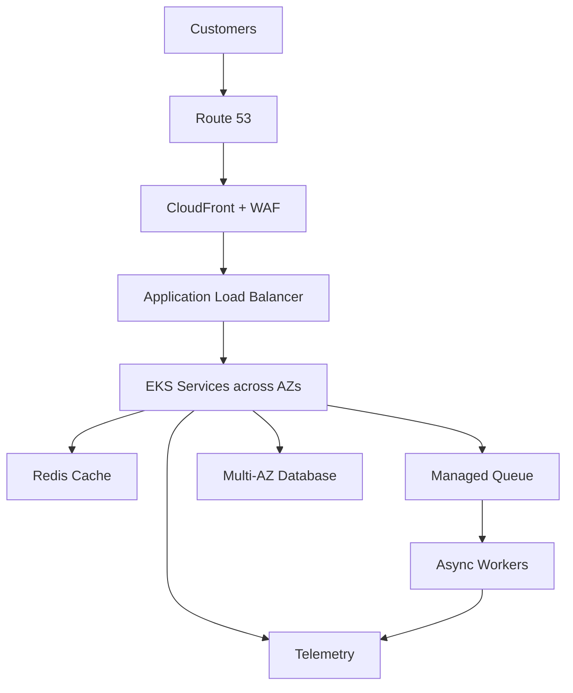
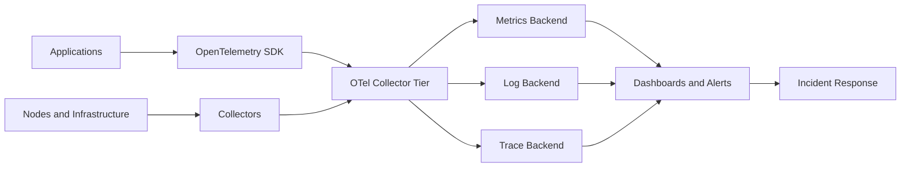
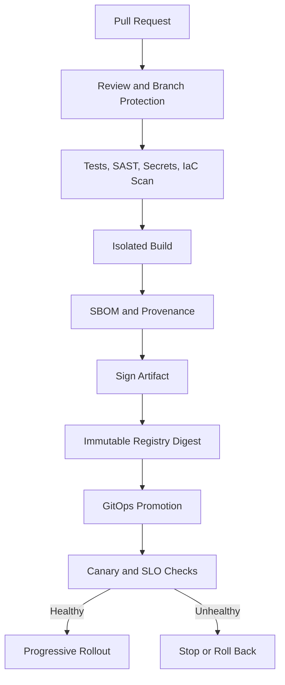

# Senior DevOps System Design — Production Interview Scenarios

These are whiteboard-style prompts with a reference design, key decisions, failure modes and validation points. They are not one-size-fits-all blueprints: clarify workload, compliance, RTO/RPO, traffic and budget before committing to a design.

## Scenario 1 — Design an enterprise Internal Developer Platform for 100 engineering teams

### Requirements to clarify
- Number of teams, services, clusters and deployments per day
- Supported languages and runtime targets
- Self-service boundaries and approval requirements
- Tenant isolation, compliance, audit and data residency
- Platform SLO, recovery objectives and cost constraints

### Reference architecture

### Design explanation
Backstage is the developer experience/catalogue layer, not the provisioning engine by itself. Templates create standard repositories and metadata. CI validates and builds immutable artifacts. GitOps promotes declarative deployment configuration. Policy checks run before merge and at admission. Secrets are retrieved through workload identity and an approved secret integration. Observability links service ownership to operational health.

### Trade-offs and failure modes
- A central platform team can become a bottleneck: publish APIs and golden paths with clear ownership.
- Shared clusters reduce cost but increase noisy-neighbor and blast-radius risk: define tenancy boundaries and quotas.
- Too many templates create maintenance burden: version and deprecate templates.
- Portal outage should not stop already-running workloads or normal GitOps reconciliation.

### Success measures
Golden-path adoption, time to first deployment, deployment frequency, change failure rate, platform SLO, support ticket volume and developer satisfaction.

## Scenario 2 — Design a highly available e-commerce platform for peak traffic

### Reference architecture

### Explain the request path
Use CDN caching for static and cacheable content, WAF for edge filtering, an ALB for ingress, and horizontally scalable stateless services across AZs. Use a managed relational database with Multi-AZ availability for transactional data, caching for hot reads, and queues for asynchronous work such as email or order events.

### Critical design decisions
- Separate synchronous checkout path from non-critical asynchronous work.
- Use idempotency keys for payment/order requests and deduplicate queue processing.
- Define cache invalidation and consistency behavior.
- Apply backpressure, bounded retries with jitter, timeouts and circuit breakers.
- Load test realistic peak and failure traffic.

### Failure cases
Database failover, queue backlog, cache outage, AZ loss, downstream payment-provider latency and traffic spikes. Define degraded modes; never silently lose an accepted order.

## Scenario 3 — Design secure multi-account AWS connectivity for a regulated enterprise

### Reference design
- AWS Organizations with workload accounts separated by environment and ownership.
- Central network account for approved transit connectivity and inspection.
- Security/log archive accounts for audit and security tooling.
- Private subnets for workloads; controlled egress and service endpoints.
- Central identity federation with role boundaries and short-lived sessions.
- SCPs for organization-wide guardrails, plus workload IAM and resource policies.

### Trade-offs
A centralized hub simplifies governance but can become a bottleneck or shared failure domain. A distributed model improves autonomy but increases policy and routing complexity. Choose based on scale, isolation, traffic patterns and operational capability.

### Validate
Route propagation, overlapping CIDRs, DNS resolution, inspection failover, endpoint policies, cross-account trust, CloudTrail coverage and break-glass access.

## Scenario 4 — Design an observability platform for 200 microservices

### Reference architecture

### Design explanation
Standardize telemetry through OpenTelemetry instrumentation and collector pipelines. Define service identity, environment, version and trace correlation fields. Apply sampling and cardinality controls. Set retention tiers and access controls. Build service dashboards around RED (rate, errors, duration) and infrastructure saturation.

### Trade-offs and risks
High-cardinality labels can make metrics expensive or unusable. Excessive logs create cost and noise. Tail sampling improves trace retention for interesting requests but requires collector capacity and design. Alert on user-impacting symptoms, not every infrastructure fluctuation.

## Scenario 5 — Design a CI/CD supply chain for production workloads

### Pipeline

### Security controls
Use OIDC federation for cloud access, minimal workflow permissions, pinned actions, protected environments, isolated runners and immutable artifact digests. Do not expose production secrets to untrusted pull-request code. Verify signatures/provenance at deployment where the ecosystem supports it.

### Reliability controls
Separate build from deployment, promote the same artifact digest across environments, use deployment health gates, preserve rollback artifacts and ensure schema changes are backward-compatible.

## Scenario 6 — Design disaster recovery for a critical business application

### Start with business requirements
Agree on RTO, RPO, data consistency, regional dependencies, compliance and maximum acceptable cost. Then choose among backup/restore, pilot light, warm standby or active/active.

| Strategy | Recovery profile | Cost/complexity |
|---|---|---|
| Backup and restore | Highest recovery time; restore from backups | Lower running cost |
| Pilot light | Core data/services prepared; scale on failover | Moderate |
| Warm standby | Reduced-capacity environment already running | Higher |
| Active/active | Traffic served in multiple regions | Highest complexity |

### Operational plan
Replicate or back up data using service-appropriate mechanisms, deploy infrastructure from versioned IaC, document identity/DNS/network prerequisites, automate safe failover where possible, and test failback. Record measured RTO/RPO during game days.

## Whiteboard checklist for every system-design question

1. Clarify functional and non-functional requirements.
2. Estimate scale: requests/sec, data size, growth, concurrency and regions.
3. Draw the request/data flow and trust boundaries.
4. Identify stateful components and consistency requirements.
5. Design for AZ, dependency and regional failures.
6. Explain security, identity, secrets and network controls.
7. Define SLI/SLO, telemetry and alerting.
8. Explain deployment, rollback, backup and DR.
9. State cost drivers and design trade-offs.
10. Describe how you would test the design before production.
